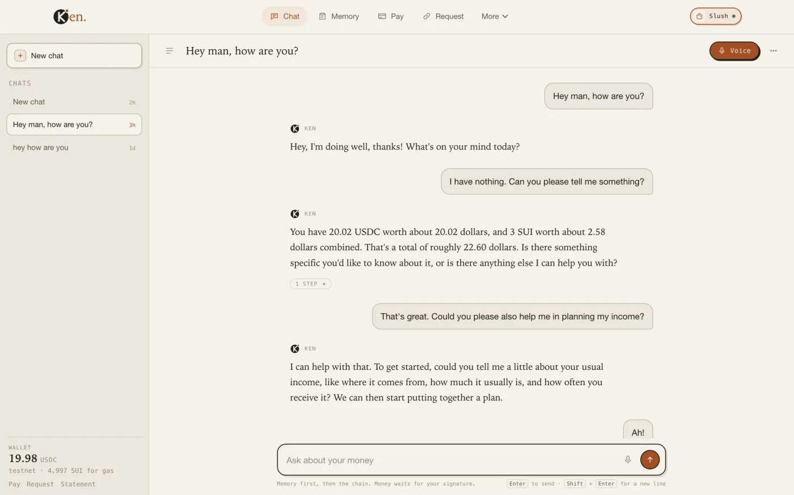
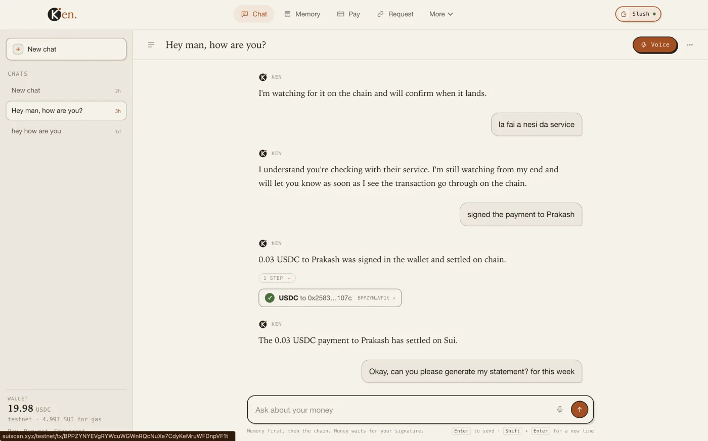
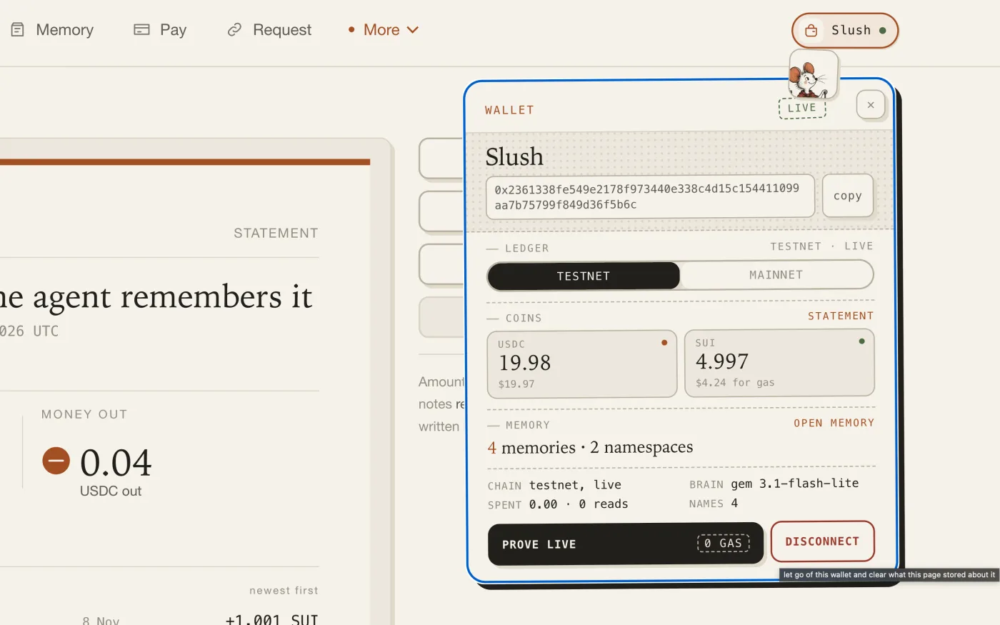
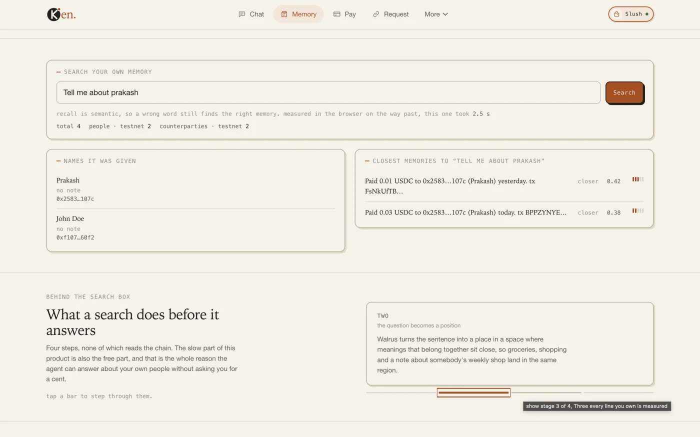
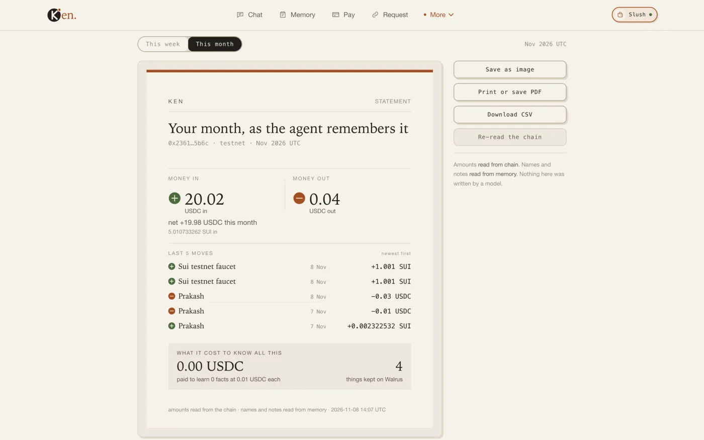
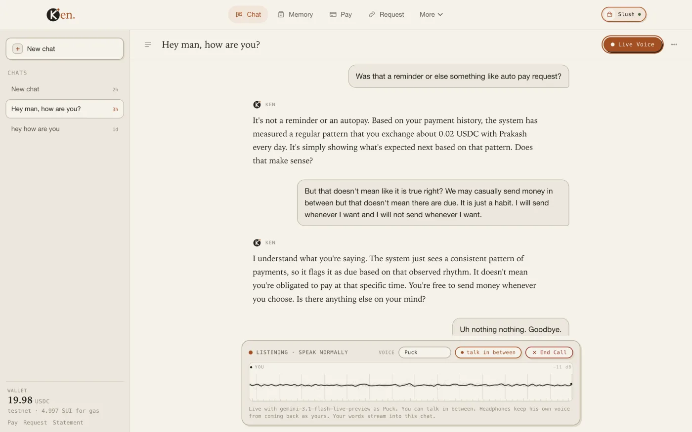
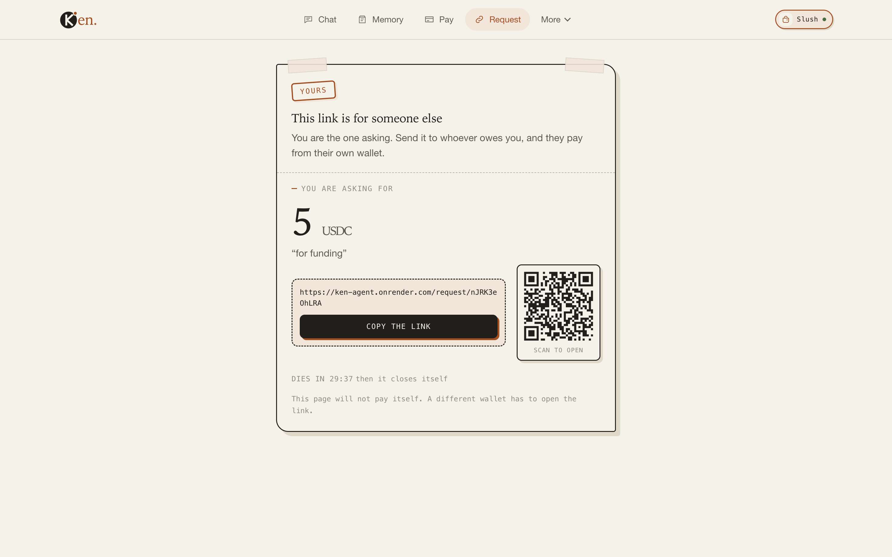

<p align="center">
  
</p>

# Ken

Ken is a personal agent for a Sui wallet. It reads the chain through Tatum, keeps your people on Walrus, and pays a few cents for a fact it has not learned yet. By default that money is `sui:mainnet` USDC, which is real money, and nothing leaves a wallet until its owner approves the transaction inside it.

It is more than a voice. Ken answers in a text chat, takes a live call, speaks a morning brief, sets a monthly limit, makes a payment request link, prints a statement, and sells or buys a memory behind a paid link. All of those share one memory and one wallet, so a name told on a call is already known when you type.

You talk to it the way you would talk to a person. It answers from memory when memory can answer, reads the chain only when memory cannot, and buys a measured profile from a paid index only when neither of those worked. Every step is shown, and every step that cost money says so.

## The loop

```
you ask, by voice or by text
  → Walrus memory is read first          free, 2 to 4 seconds
  → Tatum is read only if memory is empty free, but rate limited and slow
  → the paid index is bought only if the address is still nameless
                                        costs 0.01 USDC, or 0.03 for a busy wallet
  → the fact is written to Walrus, so the next asking is free
  → the answer is spoken, typed, or drawn on a statement
```

The point of the build is the order. A wallet explorer answers every question by reading the chain. This one tries to never read the chain twice for the same fact, and the cost meter on the page proves it.

## How it fits together

<p align="center">
  
</p>

The drawing is one room and one loop, with no boxes and no arrows. The clay thread is a single request, followed from the question to the receipt.

| In the drawing | In the build |
| --- | --- |
| The man at the desk, writing in a ledger | The one Node process that answers, and the chat store that keeps every turn |
| The telephone and the key ring beside him | Text and voice enter through the same place, and the keys stay on the server |
| The card catalogue, one drawer open, paper slips on the floor | Walrus memory, one namespace per wallet, read before anything else |
| The window onto a skyline built from chain links | Sui, mainnet or testnet, chosen per browser seat |
| The brass telescope aimed at that window | Tatum, used only when memory cannot answer |
| The booth with a bell, ticket stubs, a coin dish and a cash box whose lock holds no key | The seller on port 8788, with its own wallet and ledger, and no key of its own |
| The gramophone horn and its sound arcs | The spoken answer, in one of five voices |
| The clay thread tying them together | One request, from memory to chain to a paid fact, and back into memory |

### The market is two processes

The buyer and the seller cannot be the same call stack, so they are two processes.

`npm run sell` owns the index on port 8788, with its own payout wallet in `SELLER_WALLET` and its own ledger in `.seller.json`. It holds no key. The agent on 8787 asks for a price, gets a standard x402 v2 `PAYMENT-REQUIRED` header, and has your wallet sign the exact transfer without sending it. The signed Sui envelope goes back in `PAYMENT-SIGNATURE`. The seller's facilitator verifies that signature against those exact bytes, simulates the transfer, checks that the USDC credit at the quoted address is funded by a debit from the wallet that signed, and only then broadcasts the bytes. There is no second signature and no key on the seller side.

The price is one cent for a profile, three cents above twenty transactions because a busy wallet costs the seller more Tatum reads. The reason is published in the 402 reply. The buyer has its own ceiling in `PAID_MAX_USDC`, and a quote above it is refused rather than paid. A resource already sold to your wallet answers free, and a lost response can be retried with the same signed envelope without moving money twice.

### Who pays on mainnet

On `sui:mainnet` the payer is always the wallet connected in the browser, and the money comes out of that wallet's own USDC. There is no shared bankroll and no server key holding a person's money. Saving a name is a Walrus write and costs nothing. Sending a payment, paying a request link or buying a fact starts from `prepareUsdc` or `preparePayment`, which builds bytes for the connected address and stops. The signature happens inside the wallet extension.

| Paid action | What the wallet does | What the server does |
| --- | --- | --- |
| Save a name | Nothing | Writes the alias to this wallet's Walrus namespace. This is not a payment. |
| Send USDC or SUI | Signs and executes | Reads the transaction back from Sui before writing the receipt to memory |
| Pay a request link | Signs and executes | Checks the transfer matches the requested amount, address and network |
| Buy a fact over x402 | Signs only, no broadcast | Hands the signed bytes to the seller, whose facilitator verifies, simulates and broadcasts |
| Check a digest or open a paid link | Signs only, no broadcast | Same envelope path, then writes the bought fact to memory |

The agent's own key can sign only on testnet. `keySpendAllowed()` throws on mainnet, so `signUsdc` and `payCoin` cannot move real money even if a route called them by mistake. A per-payment cap of 5 USDC and a per-fact ceiling of 0.02 USDC (`PAID_MAX_USDC`) sit in front of every signature by default.

Gas is the one thing USDC does not cover. A mainnet payer needs a little SUI in the same account, or USDC held in the Sui address balance at 0.01 USDC or more, which Sui can move with a zero-fee transaction. `preparePayment` prefers ordinary coin objects and rebuilds the transfer in the gasless shape only when the ordinary build fails for want of SUI. If an older wallet extension cannot read the newer address-balance input, it answers "Invalid input" before its popup. The page catches that exact refusal and says the wallet is too old, that nothing was signed and no money moved, instead of showing the raw error.

## One agent, many surfaces

| Surface | What Ken does there |
| --- | --- |
| Text chat | The same tools, the same memory, and the same wallet, answered as writing. A payment ticket, an address field and a request form open under the reply. |
| Voice call | You pick one of five working voices, then talk. The answer is spoken back, and talking over it cuts it off. The call opens over the chat you are reading and writes back into it. |
| Morning brief | Ken reads what moved and what it remembers before you ask. |
| Limits | A monthly cap with a red, amber or green meter, set by typing or speaking. |
| Request links | A link that asks a named person for an amount on one ledger, dies after a set time, and carries a QR. |
| Statement | A paper card typeset from chain reads and memory, saved as PNG, PDF or CSV. |
| Paid links | A note, a profile or a chain check sold from one cent over x402, with the receipt stored so it is never bought twice. |

## In use

<p align="center">
  
</p>

<p align="center"><em>One thread on testnet. The question, the tool step and the answer stay together, and the session rail keeps older chats beside it.</em></p>

| The signed ticket | The wallet card |
| --- | --- |
|  |  |
| A signed 0.03 USDC transfer to a saved name. The check is a read back from the chain, and the digest opens in SuiVision. | Ledger, both coins, the memory count and the model, all in one card. |

| Memory on Walrus | The monthly statement |
| --- | --- |
|  |  |
| What Walrus holds for this wallet. The name Prakash was learned once, with two payments kept beside it. | The month as the agent remembers it. Money in and out, the newest five moves, and what it cost to know. |

<p align="center">
  
</p>

<p align="center"><em>The call dock under the same thread. Listening, one voice, one way to end it.</em></p>

<p align="center">
  
</p>

<p align="center"><em>A request link made from the same chat. The QR opens the same page, the countdown closes it, and the page cannot pay itself.</em></p>

## What each service does

| Piece | What it does here |
| --- | --- |
| Tatum | Every chain read. Balances, transactions, counterparty history, on both mainnet and testnet, through the Sui GraphQL gateway. |
| Walrus Memory | The agent's long term memory. Names, notes and bought receipts live in per wallet namespaces on mainnet, so a fresh session already knows who Sana is. |
| Voice | One chat with two ways in. Type, or open the call sheet and talk. The microphone stays open, the answer arrives as speech, and every finished turn is written into the same chat, so a refresh does not erase it. Five working voices, and the choice is saved. |
| Payments | Standard x402 v2 over Sui, with a separate seller process. A price arrives in a `PAYMENT-REQUIRED` header, your wallet signs the exact transfer without sending it, the signed bytes leave in `PAYMENT-SIGNATURE`, and the seller's facilitator verifies and settles them without holding a key. On mainnet the connected wallet is the only payer, because the agent's own key refuses to sign there. The fact is written to memory so the same answer is never bought twice. |

## Where it fits

| Track | Why it fits |
| --- | --- |
| Smart Agents for Real Life | An agent that remembers people, balances, habits and open commitments across sessions and devices. Text, voice, the morning brief and reminders share one memory. |
| Consumer Finance Apps | Balances, USDC and SUI payments, monthly limits, request links and statements, settled on Sui without leaving the chat. |

## Stack

Nothing here is a page framework. The hard parts are the wallet, the memory, the payment and the live socket, so the UI is plain files served by the same Node process that holds the keys.

| Layer | What it is |
| --- | --- |
| Front end | Handwritten HTML, CSS and ES modules. GSAP for motion. No React, no Next, no bundler. |
| Back end | Node.js and TypeScript run with `tsx`, on the built-in `node:http` server. |
| Data | `node:sqlite` for seats, chats, limits, links, reminders and marks, JSON files for the notes and payment ledgers. Litestream streams the databases to R2. |
| Chain | Tatum Sui GraphQL, `@mysten/sui`, Wallet Standard in the browser. |
| Memory | Walrus MemWal, one namespace per wallet. |
| Payments | x402 v2 wire and a self-hosted facilitator, USDC and SUI on Sui. |
| AI | Raw HTTP to Gemini and NVIDIA NIM, Gemini Live for calls, Fish and OpenRouter for speech. |
| Tests | `tsc`, `node --check` and 28 TypeScript test scripts. No test framework. |

## Run it

```bash
npm install && cp .env.example .env   # add provider keys to .env (all keys stay server-side)
npm start                             # starts seller (8788) and agent (8787) together
```

Open `http://127.0.0.1:8787`. Every connected wallet can switch `sui:testnet` / `sui:mainnet` in the header via zero-gas signature proof (`verifyPersonalMessageSignature`). On `429` / `503` limits, `MODEL_NAME` and `NVIDIA_MODEL` alternate (`gemini-3.1-flash-lite` -> `550B Ultra` -> `gemini-3.5-flash` -> `4B Bolt`).

| Command | Purpose | Command | Purpose |
| --- | --- | --- | --- |
| `npm start` | Launch seller (`8788`) + agent (`8787`) | `npm test` | `tsc`, JS syntax check + offline test suites |
| `npm run sell` | Run paid index (`8788`) standalone | `npm run selftest` | Offline tool loop against scripted model |
| `npm run live` | Run agent (`8787`) with `PAY_ENABLED=1` | `npm run selftest:live` | Live model loop checked against chain |
| `npm run chat` | Interactive terminal agent session | `npm run voicetest` | Test TTS fallback ladder (Fish, OR, Gemini) |
| `npm run plumb` | End-to-end check across upstream providers | `npm run seed` | Seed testnet cadence history (1 run / UTC day) |

### Cold starts

A Render free service begins every boot with an empty disk. The Docker image runs `litestream replicate` around the app, so each SQLite store in `tools/litestream.yml` is restored from Cloudflare R2 before the server opens it, then streamed back every ten seconds and on shutdown. The wallet binding in `seats.db` and the transcript in `chats.db` therefore survive a spin-down, a restart and a deploy. A restore that fails for a real reason stops the boot instead of starting empty and streaming that emptiness over the only backup. `npm start` does not use Litestream and reads the local `data/` folder.

Four files stay outside the replica. `data/notes.json` (the notes offered for sale), `.seller.json` (the seller's own sales ledger), `.paid.json` (the buyer-side receipts and stuck envelopes) and `.facilitator.json` (the replay guard) are JSON rather than SQLite. Litestream cannot copy them, so they start empty after a cold boot. The chain remains the proof that money moved.

## Pages

| Workspace (Wallet-Gated) | Purpose | Public / Link Route | Purpose |
| --- | --- | --- | --- |
| `/app` | Chat threads, session rail, balances & people | `/` | Landing overview, cost ledger & service hub |
| `/call` | Bidirectional voice dock synced into active chat | `/features` | 18-drawer live capability status grid |
| `/memory` | Searchable Walrus Mainnet ledger per wallet | `/how` | Interactive 5-chapter architecture walkthrough |
| `/pay` | Unsigned transfer & x402 signing ticket | `/life` | Weekly real-life payment & recall scenarios |
| `/request` | Single-use QR links (`TTL`, closes on pay) | `/ask/:id` | Public paywall unlock page (`x402` note) |
| `/ask` & `/report` | Sell Walrus lines · export `PNG`/`PDF`/`CSV` statement | `/report.svg` | Live server-typeset vector statement image |

## Tools (`21` core + `5` paid)

`pay_usdc`, `pay_sui`, `paid_lookup`, `verify_payment`, and `open_paid_link` load only when `PAY_ENABLED=1`.

| Domain | Tools | Key Rules |
| --- | --- | --- |
| Chain & Balances | `wallet_balance`, `money_history`, `monthly_summary`, `how_money_came`, `address_activity` | Sole source of balances. Reads newest `40`–`200` txs via Tatum (`USDC`/`SUI` split). Never invents due dates. |
| Walrus Memory | `people_you_know`, `who_is_this`, `name_a_person`, `find_person`, `remember_this`, `what_do_i_remember`, `memory_stats` | Scoped per wallet namespace. `find_person` fuzzy-matches voice recall, while spend tools demand exact address match. |
| Safety & Limits | `mark_spam`, `unmark_spam`, `spam_marks`, `set_monthly_limit` | Per-owner SQLite spam guard blocks blind sends. Cap meter reports red/amber/green spend state. |
| Briefs & Alarms | `make_report`, `remind_me`, `reminders`, `cancel_reminder` | Server typesets statements straight from reads (zero model totals). Background ticker fires due reminders. |
| Payments | `pay_usdc`, `pay_sui`, `request_money` | Builds unsigned PTBs (`pay_usdc`/`pay_sui` share one path) or time-boxed USDC QR links. The connected wallet signs. `preparePayment` prefers coin objects, then falls back to the zero-fee address-balance shape when USDC is all the account has. |
| x402 Paid Index | `paid_lookup`, `verify_payment`, `open_paid_link` | Pays `0.01`–`0.03 USDC` for address dossiers, digest checks, or locked notes. Writes receipt back to Walrus. |

## Core guarantees

| Pillar | What is built | How it stays honest |
| --- | --- | --- |
| Isolation | Per-browser seats (`AsyncLocalStorage` + `tr_seat`), Wallet Standard gate on workspace routes & `/speak` | Ed25519 challenge proof on connect/switch. SQLite tables keyed by `owner` (`sessions`, `marks`, `caps`, `reminders`). |
| Chain Reads | Reverse chronological Tatum paging (`last` + `before`) with `429` retry + CoinGecko USD lookup | Separates SUI vs USDC decimals, labels & excludes faucet from people, omits USD total if price feed fails. |
| Non-Custody | Two-process x402 market (`8787` buyer / `8788` facilitator+seller) + client-side PTB signing | Server holds zero user keys, and its own signing key is testnet-only. Facilitator simulates balance deltas before broadcast. Replay & `PAID_MAX_USDC` guards. |
| Voice & Proof | Plain `node:http` SSE live audio (zero WS libs) + Gemini Live + 83-language TTS (`/speak`) | Acoustic echo floor-gating, ungrounded model digits stripped, exported statements drawn deterministically. |
| Paid Knowledge | `/ask` locks stored Walrus lines by owner. `open_paid_link` pays writer & caches to buyer memory | Server reads words back from store only after chain settlement. `/earned` sums verified receipts only. |